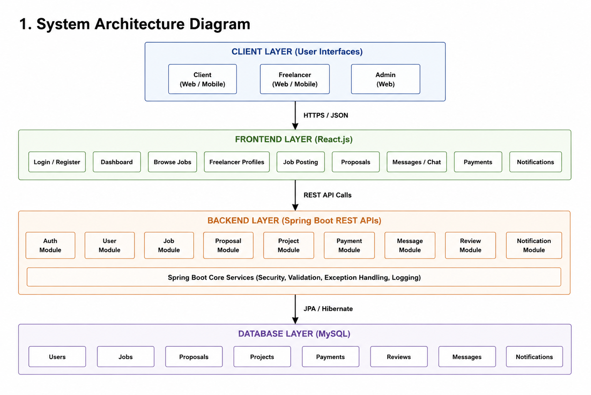
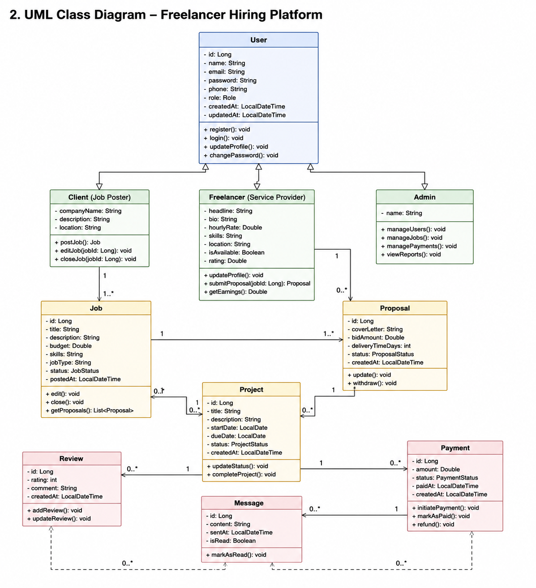
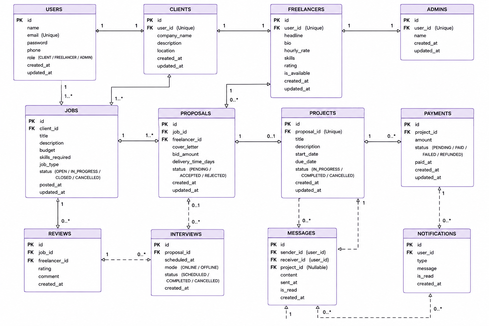

# Freelancer Hiring Platform (Upwork-style)

## Author

**Name:** KESHAMALINI V
**Role:** Full Stack Developer
**Project Type:** Final Year Mini Project

## Project Overview

The Freelancer Hiring Platform (Upwork-style) is a full-stack web application developed to connect clients and freelancers through a secure online marketplace. It enables clients to post projects, receive proposals, hire skilled freelancers, monitor project progress, manage payments, and provide feedback. Freelancers can create professional profiles, search for jobs, submit proposals, communicate with clients, and complete assigned projects. Built using React.js, Spring Boot, and MySQL, the platform provides a scalable, secure, and efficient solution for freelancer hiring and project management.

## Features & Key Modules

**Authentication Module**
Provides secure user registration, login, and JWT-based role authentication.

**Client Management Module**
Allows clients to post jobs, review proposals, hire freelancers and manage projects.

**Freelancer Management Module**
Enables freelancers to manage profiles, browse jobs and submit proposals.

**Job & Project Management Module**
Supports job posting, project assignment, milestone tracking and completion.

**Payment & Review Module**
Maintains payment history and ratings.

**Messaging & Administration Module**
Supports messaging, notifications and administration.

## System Architecture



## UML Class Diagram



## Entity Relationship (ER) Diagram



## Technology Stack

| Layer | Technology | Purpose |
|---|---|---|
| Frontend | React.js | User Interface |
| Backend | Spring Boot | REST APIs & Business Logic |
| Database | MySQL | Data Storage |
| Development Tools | Maven, Git, GitHub, Postman | Build, Version Control & API Testing |

## Repository Structure

```
Freelancer-Hiring-Platform/
├── backend/
│   ├── src/main/java/com/freelancer/
│   │   ├── controller/
│   │   ├── service/
│   │   ├── repository/
│   │   ├── model/
│   │   ├── security/
│   │   └── config/
│   ├── src/main/resources/
│   ├── pom.xml
│   └── mvnw
├── frontend/
│   ├── public/
│   ├── src/components/
│   ├── src/pages/
│   ├── src/services/
│   ├── src/context/
│   ├── src/assets/
│   ├── src/styles/
│   ├── App.js
│   ├── index.js
│   └── package.json
├── database/
│   ├── freelancer_hiring.sql
│   └── sample_data.sql
├── docs/
├── screenshots/
├── README.md
├── LICENSE
└── .gitignore
```

## Quick Start Guide

- Install Java JDK 17+, Node.js, MySQL, Maven and Git.
- Clone the repository.
- Create the `freelancer_hiring` MySQL database and import the SQL file.
- Configure `application.properties` with database credentials.
- Run the backend using Maven.
- Run the frontend using `npm install` and `npm start`.
- Open `http://localhost:3000` and log in as Client or Freelancer.

## Future Enhancements

- Implement an AI-based recommendation system to suggest suitable freelancers based on skills, experience, and project requirements.
- Integrate a secure online payment gateway with automated invoice generation and transaction tracking.
- Provide real-time chat and instant notifications to improve communication between clients and freelancers.
- Develop Android and iOS mobile applications for seamless access from mobile devices.
- Introduce advanced analytics and reporting dashboards for project performance, hiring trends, and earnings.
- Deploy the platform on cloud infrastructure using Docker and DevOps practices to improve scalability, security, and reliability.

## License

This project was developed by KESHAMALINI V, B.Tech Information Technology (Third Year), Department of Information Technology, as a Mini Project for academic and educational purposes. The project may be modified and extended for learning, research, and future development.
